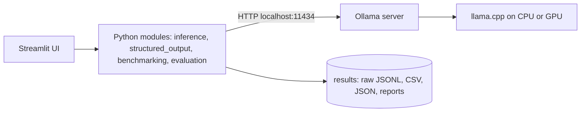
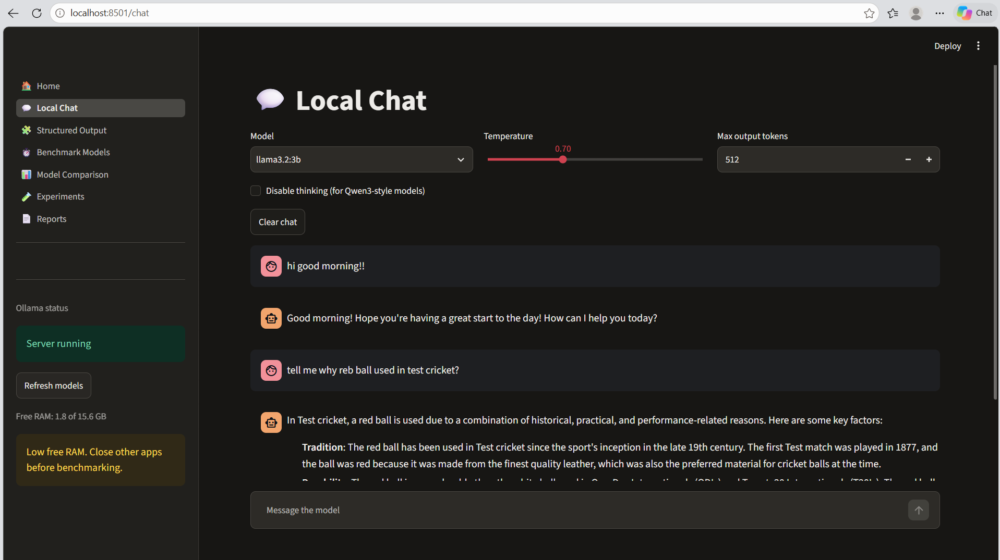
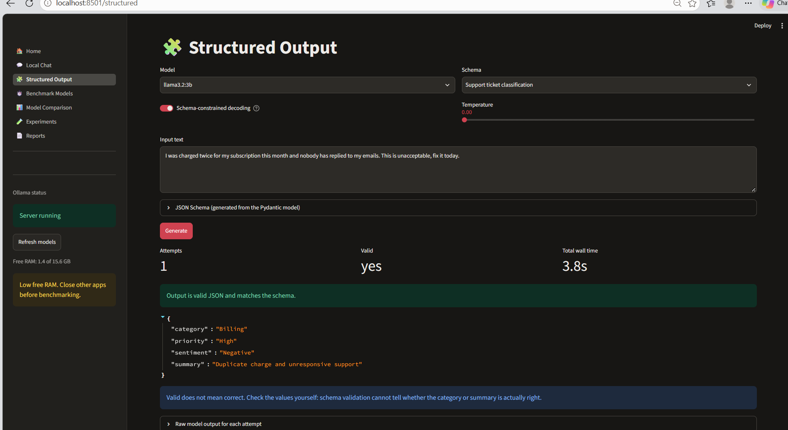

# LocalMind: Local SLM Assistant & Benchmarking Platform

Run small language models on your own computer through Ollama, get schema-validated
JSON, and choose a model using **measured** speed, memory and quality instead of guesses.

## Overview
LocalMind is a Streamlit app and Python toolkit built on Ollama. It offers streaming chat,
structured output with Pydantic validation and retry, a benchmark engine (TTFT, latency,
tokens/sec, RAM), a model comparison dashboard, temperature and quantization experiments,
and downloadable reports. No cloud LLM API is used.

## Problem statement
Model leaderboards don't tell you how a model behaves on *your* hardware and *your* task.
Local inference trades speed, memory and quality, and the fastest model is rarely the best one.

## Objectives
- Run and chat with local models.
- Produce JSON that is validated, not just parseable.
- Measure performance with a fair, reproducible methodology and keep raw data.
- Recommend a model from measurements, with the trade-offs stated.

## Features
- Streaming chat with temperature and token controls, history, and clear error handling
- Structured output: 3 Pydantic schemas, schema-constrained decoding, one corrective retry
- Benchmark engine: cold/warm separation, warm-up, repeated trials, raw JSONL, CSV and JSON export
- Dashboard: tables, 5 chart types, weighted recommendation
- Experiments: temperature 0 vs 0.7, quantization variants (with a validity check)
- Reports: Markdown summary, CSV and JSON downloads

## Architecture

Details: [docs/architecture.md](docs/architecture.md)

## Technology stack
Python, Ollama, Pydantic, pandas, psutil, Streamlit, Plotly, pytest, Ruff, Docker and Compose.
Deliberately not used: LangChain, Kubernetes, Kafka.

## Installation
```powershell
git clone https://github.com/<you>/localmind-slm.git
cd localmind-slm
python -m venv .venv
.\.venv\Scripts\Activate.ps1
pip install -r requirements-dev.txt
```

## Ollama setup
Install from https://ollama.com, then `ollama pull llama3.2:3b` (or another model sized for
your RAM; see [docs/model_selection.md](docs/model_selection.md)).

## Usage
```powershell
streamlit run frontend/streamlit_app.py                       # the app
python -m scripts.run_chat --model <model>                    # terminal chat
python -m scripts.run_structured --model <model> --schema ticket
python -m scripts.run_benchmark --models <model1> <model2>
python -m scripts.run_experiments temperature --model <model>
python -m scripts.export_results                              # CSV, JSON, report, charts

```

## Benchmark methodology
Same prompts, temperature 0, seed 42, `num_ctx` 4096 and the same token limits for every
model; true cold start (models unloaded first); one discarded warm-up; warm trials in
trial-major order; every trial written to disk immediately; failures recorded, never
filled in. Full details: [docs/benchmarking.md](docs/benchmarking.md)

## Performance results
Machine: Windows 11, Intel Core CPU, 16GB RAM, CPU-only, Best Performance mode. Date: 2026-11-11.

| model | trials_ok | trials_failed | avg_wall_s | median_wall_s | avg_ttft_s | agg_tps | avg_ram_peak_mb | avg_quality | schema_success_rate |
|---|---|---|---|---|---|---|---|---|---|
| llama3.2:3b | 24 | 0 | 1.77 | 1.04 | 0.60 | 12.32 | 79.39 | 0.96 | 1.00 |
| qwen3:4b | 24 | 0 | 11.95 | 14.25 | 1.00 | 8.87 | 80.00 | 0.75 | 1.00 | 

| model | avg_quality | schema_success_rate | score |
|---|---|---|---|
| llama3.2:3b | 0.96 | 1.00 | 1.00 |
| qwen3:4b | 0.75 | 1.00 | 0.15 | 

Highest weighted score: `llama3.2:3b`. Fastest generation: `llama3.2:3b`. Highest quality: `llama3.2:3b`. Lowest peak RAM: `llama3.2:3b`.

## Model comparison
Comparing llama3.2:3b against qwen3:4b on your system revealed distinct performance trade-offs across all key evaluation criteria. llama3.2:3b decisively won on speed and efficiency, achieving a weighted score of 1.00 and an aggregate throughput of 12.32 tokens/sec with an average wall time of 1.77s, while qwen3:4b lagged behind at an average wall time of 11.95s due to internal reasoning overhead. Both models attained a flawless 1.00 schema success rate for structured JSON outputs, but llama3.2:3b also achieved a higher overall rule-based quality score (0.96 vs 0.75). Consequently, llama3.2:3b is the ideal choice for general-purpose local deployment and low-latency interactive workflows, whereas larger models like qwen3:4b would only be selected if deep internal chain-of-thought processing outweighs speed constraints on powerful dedicated hardware.

## Temperature experiments
| temperature | prompts | unique_mean | exact_agreement | similarity | quality | schema_valid_rate |
|---|---|---|---|---|---|---|---|
| 0.00 | 12.00 | 1.17 | 0.94 | 0.98 | 1.00 | 1.00 |
| 0.70 | 12.00 | 1.75 | 0.75 | 0.92 | 1.00 | 1.00 |

**Observation:** At $T = 0.00$, exact agreement is very high (`0.94`), confirming that greedy decoding heavily minimizes output drift (though floating-point non-determinism means it may not reach a pure 1.0). At $T = 0.70$, exact agreement drops to `0.75` and unique responses increase (`1.75`), showing successful generative variation while keeping quality scores identical (`1.00`) for these short prompt types.

## Quantization experiments
| model | quantization | disk_gb | model_mem_mb | agg_tps | avg_wall_s | avg_quality | schema_success_rate |
|---|---|---|---|---|---|---|---|
| qwen2.5:3b-instruct-q5_K_M | Q5_K_M | 2.07 | 2349.17 | 12.28 | 1.92 | 1.00 | 1.00 |
| qwen2.5:3b-instruct-q8_0 | Q8_0 | 3.06 | 3360.69 | 8.52 | 2.71 | 1.00 | 1.00 |

**Observation:** Comparing `Q5_K_M` against `Q8_0` on `qwen2.5:3b`, the lower-precision `Q5_K_M` achieved **12.28 tokens/sec** compared to `Q8_0`'s **8.52 tokens/sec**, proving that memory bandwidth savings on lower bit-widths can yield faster token generation without sacrificing schema success rate or rule-based quality (`1.00` across both).

## Screenshots
| Chat | Structured output | Comparison |
|---|---|---|
|  |  |  |

## Project structure
```text
app/         backend: core, models, inference, structured_output, benchmarking, evaluation, utils
frontend/    Streamlit entry point, views/ (pages), components/
configs/     benchmark.yaml

data/        benchmark/prompts.json (36 prompts, 6 categories)
scripts/     CLI entry points
tests/       unit, benchmarking, integration
docs/        architecture, methodology, decisions, limitations, curated results
deployment/  Dockerfile, docker-compose.yml
```

## Testing
```powershell
pytest -m "not integration"      # no Ollama needed
pytest tests/integration -v      # needs Ollama, skips cleanly otherwise
ruff check . ; ruff format --check .
```

## Deployment
Local (recommended): see [docs/setup.md](docs/setup.md). Docker:
```powershell
docker compose -f deployment/docker-compose.yml up --build -d
```
Opens at http://localhost:8501 and uses the Ollama running on your host. A hosted cloud app
cannot reach your local Ollama; see the optional remote-inference architecture in the docs.

## Limitations
Results depend on this hardware, rule-based quality scoring is a proxy, the prompt set is small,
and RAM is approximate. Full list: [docs/limitations.md](docs/limitations.md)

## Future improvements
- LLM-as-judge or human review alongside rule-based scoring
- Larger prompt sets and confidence intervals
- GPU runs and concurrent-user load tests
- Remote inference deployment with authentication


## License
MIT