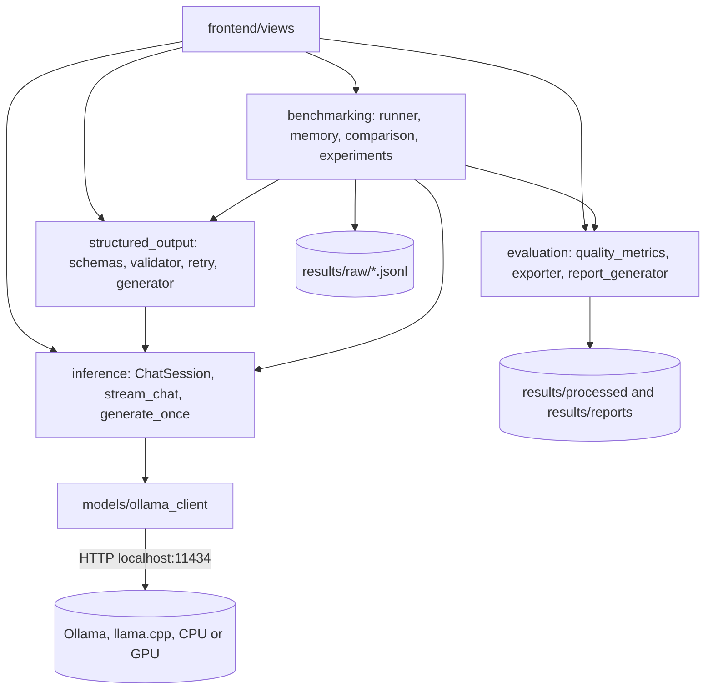
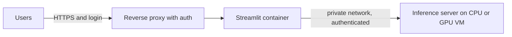

# Architecture

## Layers
- **Frontend** (`frontend/`): Streamlit pages. Views hold no inference logic; they call `app.*`.
- **Inference** (`app/inference`): `GenerationParams` (validated options), `stream_chat`,
  `generate_once`, `ChatSession` (owns history), `GenerationStats` (timing and tokens).
- **Structured output** (`app/structured_output`): Pydantic schemas, two-stage validator,
  retry builder, generator.
- **Benchmarking** (`app/benchmarking`): runner, latency statistics, throughput, memory monitor,
  comparison and recommendation, experiments.
- **Evaluation** (`app/evaluation`): rule-based quality scoring, exporter, report generator.
- **Ollama client** (`app/models/ollama_client.py`): one shared client, model discovery,
  error translation into project exceptions.

## Data flows
**Chat:** UI -> `ChatSession.send_stream` -> full history + new message -> `POST /api/chat`
(stream) -> text chunks to the UI -> final chunk carries timing stats -> history updated only if
the reply completed.

**Structured output:** schema -> JSON Schema (`format`) -> generate -> `json.loads` -> Pydantic
`model_validate` -> on failure, one retry with the error fed back -> `StructuredResult`.

**Benchmark:** unload models -> cold request -> warm-up -> warm trials -> one JSONL row per trial
(flushed immediately) -> `analyze` -> summaries -> CSV, JSON, Markdown, charts.

## Optional cloud architecture
A hosted app cannot reach a laptop's Ollama. Use a separate inference server:

Cost, privacy, security and operations implications: see `docs/setup.md`.